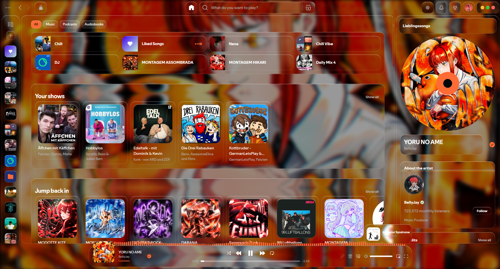
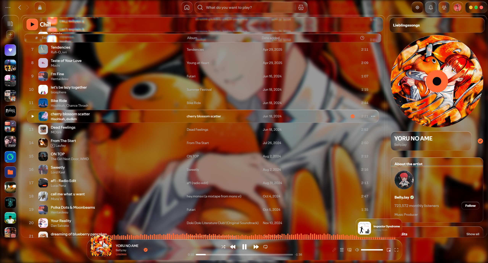
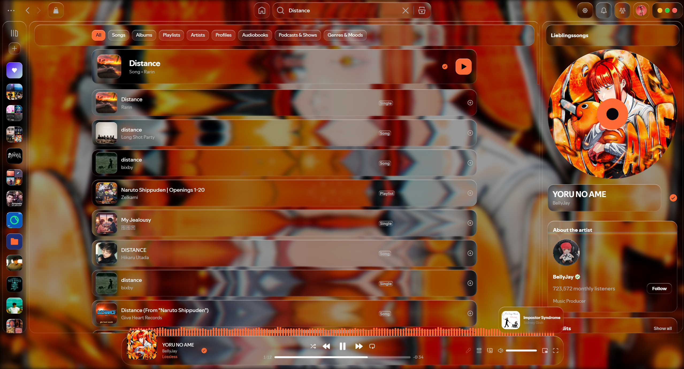
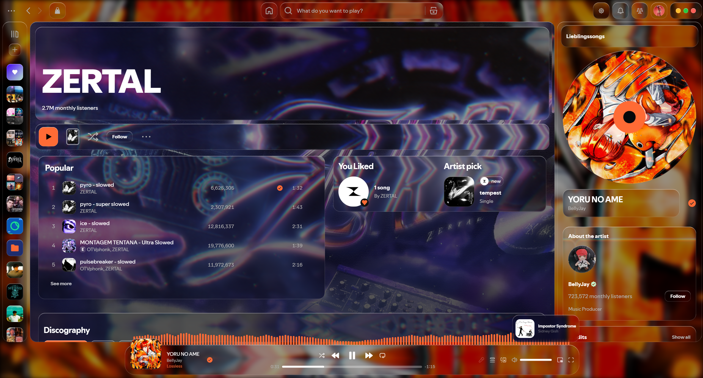
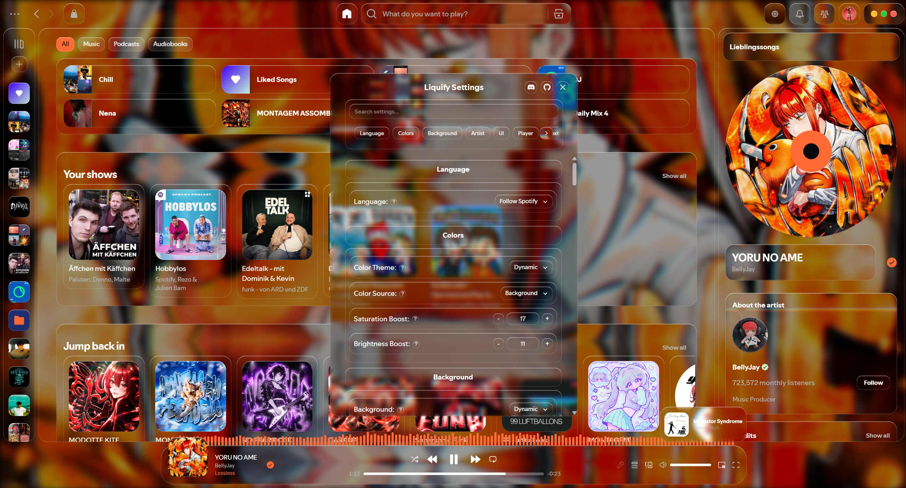
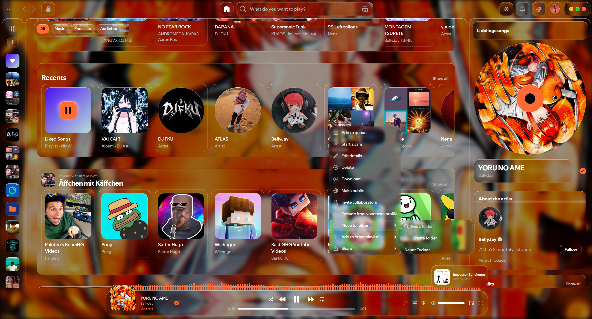
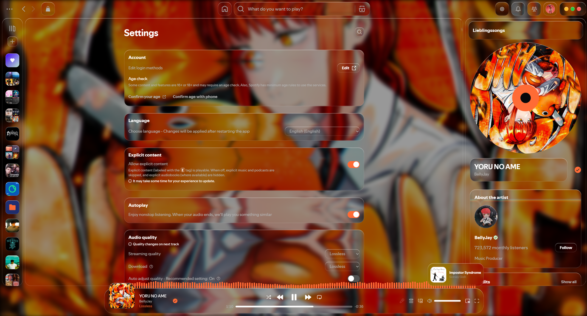
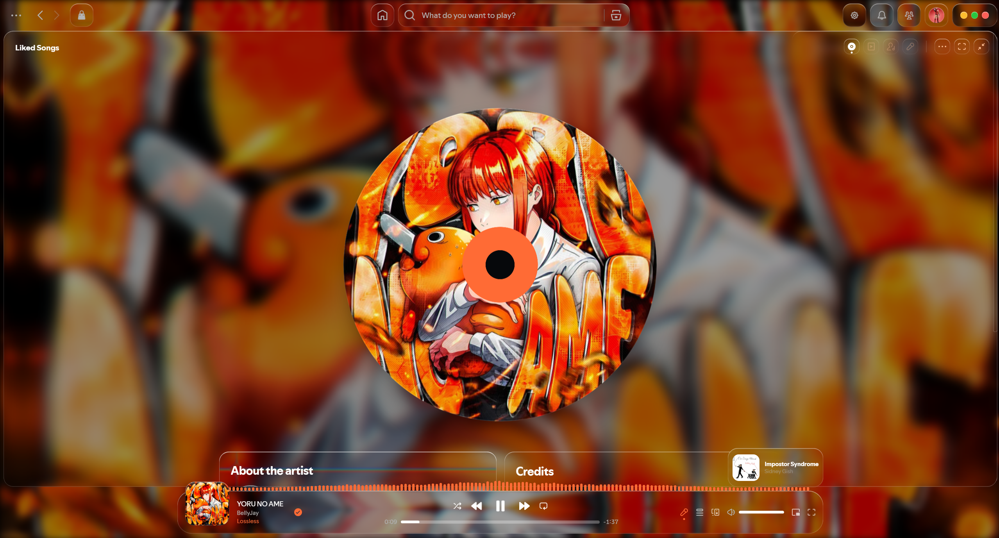

<h1 align="center"> ✨ Liquify Theme for SpotiKit ✨ </h1>

<p align="center">
  <b>A modern, rounded and liquified theme for SpotiKit</b><br>
</p>

## Contents

<!-- toc -->

- [Introduction](#introduction)
- [Installation](#installation)
- [Theme screenshots](#theme-screenshots)
- [Features](#features)
- [Building from source](#building-from-source)
<!-- tocstop -->

## Introduction

**Liquify** - is a liquid glass theme for Spotify, made for [SpotiKit](https://github.com/NMWplays/SpotiKit), featuring a modern, luminous interface and smooth animations.

Liquify is inspired by [Glassify](https://github.com/sanoojes/spicetify-glassify) from [Sanoojes](https://github.com/sanoojes).

Prefer Windows-style window buttons over the macOS ones? You can switch them on in the Liquify Settings.

If you like the theme, consider starring the repository on GitHub! ⭐

**For support join the Discord!**:

<a href="https://discord.gg/QRMnrgjhvq" target="_blank">
  
</a>

## Installation

Open the **SpotiKit Marketplace**, search for **Liquify** and install it. On the first start, a short tour shows you around the Liquify Settings and offers to install Liquid Lyrics.

## Theme screenshots

<details>
<summary>Click to watch screenshots</summary>
















</details>

---

## Features

**Liquify offers:**

- Liquid glass with real refraction, rounded and modern UI
- Many customization options in the Liquify Settings
- Beautiful dynamic colors, taken from the cover or your background
- Animated backgrounds, your own images or URLs as background
- Vinyl cover art, cover flip and cover swipe animations, a floating player and a next song card
- [Liquid Lyrics](https://github.com/NMWplays/Liquid-Lyrics), the official lyrics extension for Liquify
- And much more!

## Building from source

```sh
npm install
npm run build
```

`src/` builds into `dist/theme.js`. `theme.css` holds the static styles and is not built. `npm run deploy` builds and copies `theme.js` into SpotiKit's theme folder.

The `main` branch holds the Spicetify version of Liquify.

## Credits

Created by NMW.

## License

This project is licensed under the GNU Affero General Public License v3.0 (AGPL-3.0). See the [LICENSE](LICENSE.txt) file for details.
