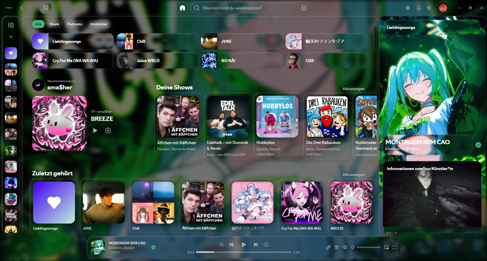

# Liquify for SpotiKit

A modern, rounded and liquified liquid glass theme for Spotify, built for
[SpotiKit](https://github.com/NMWplays/SpotiKit).



## Install

Open the SpotiKit Marketplace, search for **Liquify** and install it.

Liquify Settings opens from the gear button in the top bar. Everything is
adjustable there: backgrounds, accent colors, glass, the player, the next song
card, vinyl cover art, lyrics and more.

For lyrics, [Liquid Lyrics](https://github.com/NMWplays/Liquid-Lyrics) is the
official companion extension.

## Build from source

```sh
npm install
npm run build
```

`src/` builds into `dist/theme.js`. `theme.css` holds the static styles and is
not built. `npm run deploy` builds and copies `theme.js` into SpotiKit's theme
folder (`%APPDATA%/SpotiKit/Themes/Liquify V2`).

The `main` branch holds the Spicetify version of Liquify.

## License

See [LICENSE.txt](LICENSE.txt).
